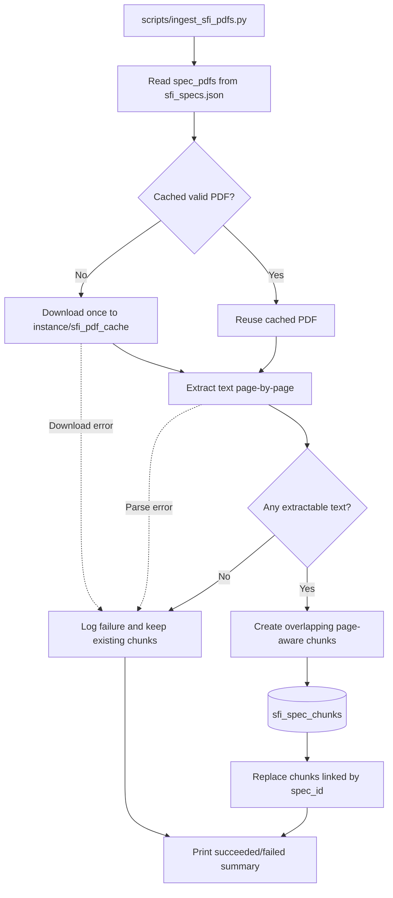
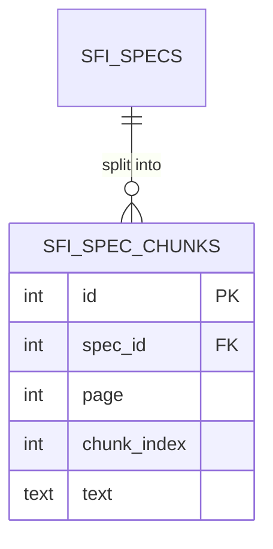
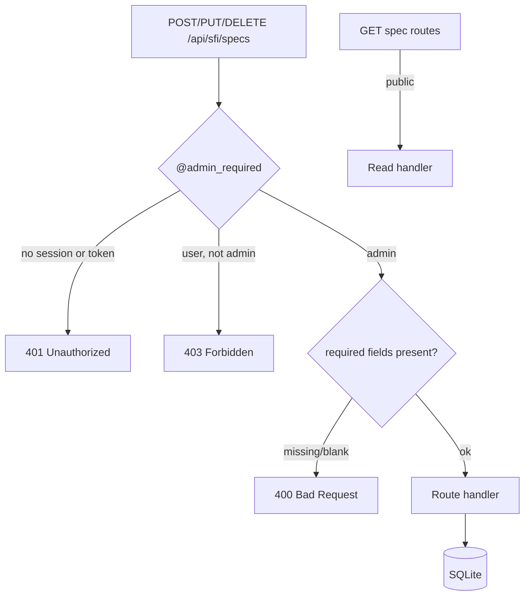

# SFI Foundation Prototype Backend

This repository contains the Flask API backend for the Greppers SFI Foundation capstone prototype. It supports the SFI frontend with specification search, machine-learning classification, chatbot responses, authentication, and user gear tracking.

The prototype is meant to show how SFI Foundation's public standards and PDF resources could become easier to search, update, and personalize. It is not a production replacement for the official SFI Foundation website.

## Backend Role

The Flask backend provides:

- SFI specification database import and API access.
- Spec search, category, stats, create, edit, and delete endpoints.
- Text-based ML classifier for matching part descriptions to SFI specs.
- Gemini-backed chatbot endpoint for SFI spec questions.
- User authentication and current-user lookup through the existing starter auth system.
- Authenticated "My Gear" storage for user safety equipment.

## Important Files

| Path | Purpose |
| --- | --- |
| `main.py` | Registers Flask blueprints, including all SFI APIs. |
| `api/sfi_spec.py` | SFI spec list/search/CRUD/categories/detect/stats endpoints. |
| `api/sfi_classifier.py` | ML text classifier endpoints. |
| `api/sfi_chat.py` | Gemini-backed chatbot endpoint. |
| `api/user_gear.py` | Authenticated user gear CRUD endpoints. |
| `model/sfi_spec.py` | SQLAlchemy model for SFI specs and import from frontend JSON. |
| `scripts/ingest_sfi_pdfs.py` | Downloads and indexes text chunks from official SFI spec PDFs. |
| `model/sfi_classifier.py` | TF-IDF plus LinearSVC classifier for part/spec prediction. |
| `model/user_gear.py` | SQLAlchemy model for user equipment tracking. |
| `__init__.py` | Flask app setup, CORS, environment config, and database configuration. |

## SFI API Endpoints

Implemented endpoints:

| Method | Endpoint | Purpose |
| --- | --- | --- |
| `GET` | `/api/sfi/specs` | List all specs, with optional `?category=` filter. |
| `POST` | `/api/sfi/specs` | Create a new spec record. Currently not admin-protected. |
| `GET` | `/api/sfi/specs/search?q=...` | Keyword search across spec number, product name, category, and subcategory. |
| `GET` | `/api/sfi/specs/<id>` | Get one spec by ID. |
| `PUT` | `/api/sfi/specs/<id>` | Update one spec by ID. Currently not admin-protected. |
| `DELETE` | `/api/sfi/specs/<id>` | Delete one spec by ID. Currently not admin-protected. |
| `GET` | `/api/sfi/categories` | Return distinct SFI spec categories. |
| `GET` | `/api/sfi/stats` | Return total specs, categories, subcategories, and category counts. |
| `POST` | `/api/sfi/classify` | Classify a free-text part description into likely SFI specs. |
| `GET` | `/api/sfi/classifier/status` | Return classifier training/status metadata. |
| `POST` | `/api/sfi/chat` | Send a chatbot message and receive a Gemini-generated response. |
| `GET` | `/api/sfi/gear` | List current authenticated user's gear. |
| `POST` | `/api/sfi/gear` | Add gear for the current authenticated user. |
| `DELETE` | `/api/sfi/gear/<id>` | Delete one current-user gear item. |
| `GET` | `/api/sfi/gear/pending` | Admin-only pending queue, oldest first, with owner metadata. |
| `GET` | `/api/sfi/gear/all` | Admin-only gear list; optional `status` and numeric owner `user` filters. |
| `PUT` | `/api/sfi/gear/<id>/review` | Admin approves/rejects with `status` and `notes`; rejection requires notes. |
| `PATCH` | `/api/sfi/gear/<id>/status` | Compatible status action using `note`; admin or delegated approval permission. |

See [gear review API contracts, diagrams, and verification](docs/capstone/gear-review-api.md).

Partially implemented or prototype-only behavior:

- `POST /api/sfi/detect` exists, but it is keyword-based. It is separate from the browser-side detector in the frontend.
- Standalone admin/group endpoints expected by the frontend `/admin/` page are not implemented yet.

## Data Flow

The importer and classifier JSON fallback share `sfi_config.load_specs()`.
The default source is sibling `Frontend/_data/sfi_specs.json`:

```text
sfi-foundation/
  Frontend/_data/sfi_specs.json
  Backend/
```

Set `SFI_SPECS_PATH` for a different layout (for example this workspace's
`../SFI-Frontend/_data/sfi_specs.json`). Relative overrides resolve from the
Backend repository, never the shell's working directory; absolute paths and
`~` are supported. Empty uses the default. Missing files, malformed JSON and
invalid entries raise `SpecDataError` with the resolved path. Validation occurs
before the importer clears rows. Classifier retraining still prefers current
DB rows so admin edits remain supported; JSON fallback uses the same loader.
Saved classifiers are retrained when the training-data fingerprint changes.

## SFI PDF Text Ingestion

Run the ingestion pipeline from the repository root:

```bash
python scripts/ingest_sfi_pdfs.py
```

The script reads unique `spec_pdfs` paths from `sfi_specs.json`, resolves relative
paths against `https://sfifoundation.com/wp-content/pdfs/`, and stores downloaded
PDFs in the ignored `instance/sfi_pdf_cache/` directory. Set `SFI_PDF_BASE_URL`
to override that base. Cached valid PDFs are reused on later runs. Text is
extracted page-by-page and stored as overlapping 800-character chunks in
`sfi_spec_chunks`; each row has a `spec_id`, one-based `page`, and per-spec
`chunk_index`. A successful re-run replaces that spec's chunks rather than
duplicating them. Failed downloads, scanned/no-text PDFs, and parse errors are
logged and skipped without discarding existing chunks.





## Local Setup

Create and activate a Python virtual environment:

```bash
python -m venv venv
source venv/bin/activate
```

Install dependencies:

```bash
pip install -r requirements.txt
```

Copy the placeholder-only example and replace passwords and the session secret:

```bash
cp .env.example .env
```

The app loads Backend's `.env` independently of the current directory. Existing
environment variables take precedence. Gemini is optional; database credentials
are optional (blank selects local SQLite). `FLASK_PORT` defaults to 8423.
`IS_PRODUCTION=true` retains the existing HTTPS credential-cookie behavior for
the current Open Coding Society service; its cookie domain is still
`.opencodingsociety.com`. A replacement host needs cookie/deployment verification.

Initialize **only a disposable local database**:

```bash
python scripts/db_init.py
```

This initializer drops tables after confirmation. Do not run it against an
existing/shared database to apply this configuration change; no schema migration
is required. The repository includes prototype SQLite files: in a disposable
clone only, use a new empty `instance/volumes/user_management.db` and accept the
initializer prompt (main imports create tables before that prompt).

Run the backend:

```bash
python main.py
```

The expected local backend base URL is:

```text
http://localhost:8423
```

## Frontend Integration

The companion frontend expects the backend at:

- Local: `http://localhost:8423`
- Deployed: `https://greppers-be.opencodingsociety.com`

The frontend pages that depend on this backend include:

- `/sfi-specs/` for specs, stats, classifier, and spec CRUD.
- `/quiz/` for authenticated gear sync.
- `/login/` and `/signup/` for auth.
- Site-wide chatbot widget for `/api/sfi/chat`.
- `/admin/`, although the required admin endpoints are currently missing.

Flask owns credentialed CORS, including OPTIONS; both checked-in nginx templates
forward requests without adding CORS headers. Exact allowed origins are
`https://sfi-foundation.github.io` and HTTP localhost/127.0.0.1 ports
4000, 4100, 4500, 4600, 8000, 8080 and 8423. Origins have no `/Frontend` path.
Unapproved Origin headers receive 403 without allow-origin headers; requests
without Origin remain usable by CLI clients. `Vary: Origin` separates caches.
Authentication/authorization remain required independently of CORS.

Frontend `sfi_api_base` in `_config.yml` configures the shared API base for
SFI pages and auth. Blank preserves the current service listed above; no new
production URL is confirmed. Deployment/nginx reload, browser authentication
on Pages, and production CORS verification remain pending.

See [the feature diagram and capstone notes](docs/sfi-config.md).

## Known Gaps

- No implemented admin/group endpoints for the standalone frontend `/admin/` page.
- Spec create, update, and delete endpoints are not currently restricted to admin users.
- Gear review backend is implemented; frontend review/status integration is tracked in Frontend #3.
- Chatbot does not yet retrieve PDF chunks or crawl the website; it only receives compact spec rows from the database.
- PDF extraction and chunk storage are implemented; PDF summaries, search, and chatbot retrieval remain future work.
- `/api/sfi/detect` is keyword-based and separate from the frontend's TensorFlow.js image detector.
- Focused gear review/model/migration tests are in `tests/`; full-application regression tests are in `testing/test_sfi_profile.py`.

## Future Roadmap

- Add admin-auth-protected SFI management endpoints.
- Complete frontend admin integration with the existing user/group and gear review APIs.
- Add a PDF ingestion pipeline that downloads or reads SFI PDFs, extracts text, chunks/indexes content, and exposes summary/search endpoints.
- Upgrade the chatbot to retrieve from specs, site pages, and PDF chunks before calling Gemini.
- Add route/API tests for SFI specs, classifier, chat error handling, and gear CRUD.

## Handoff Checklist

Before continuing backend work:

- Confirm sibling `Frontend/_data/sfi_specs.json` exists, or set `SFI_SPECS_PATH`.
- Initialize only a disposable database with `python scripts/db_init.py`; preserve existing data.
- Start the backend and test `GET /api/sfi/specs`.
- Test `GET /api/sfi/classifier/status` to confirm the classifier trained.
- Configure `GEMINI_API_KEY` before testing `POST /api/sfi/chat`.
- Run `python scripts/ingest_sfi_pdfs.py` to refresh the local SFI PDF chunk index.
- Treat the `/admin/` frontend as unfinished until the backend admin endpoints and permission checks are added.

## SFI spec write access (admin only)

`POST/PUT/DELETE /api/sfi/specs[/<id>]` are protected by `@admin_required` (`api/auth_utils.py`). GET routes stay public. The `/sfi-specs/` admin panel is only shown when `/api/sfi/me` reports an admin.


