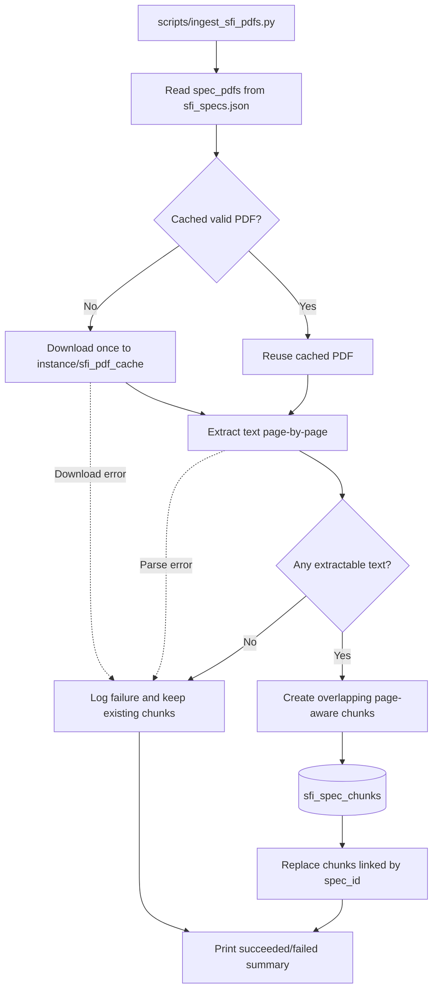
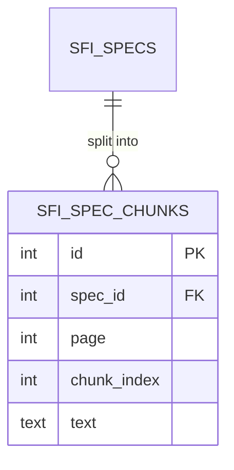
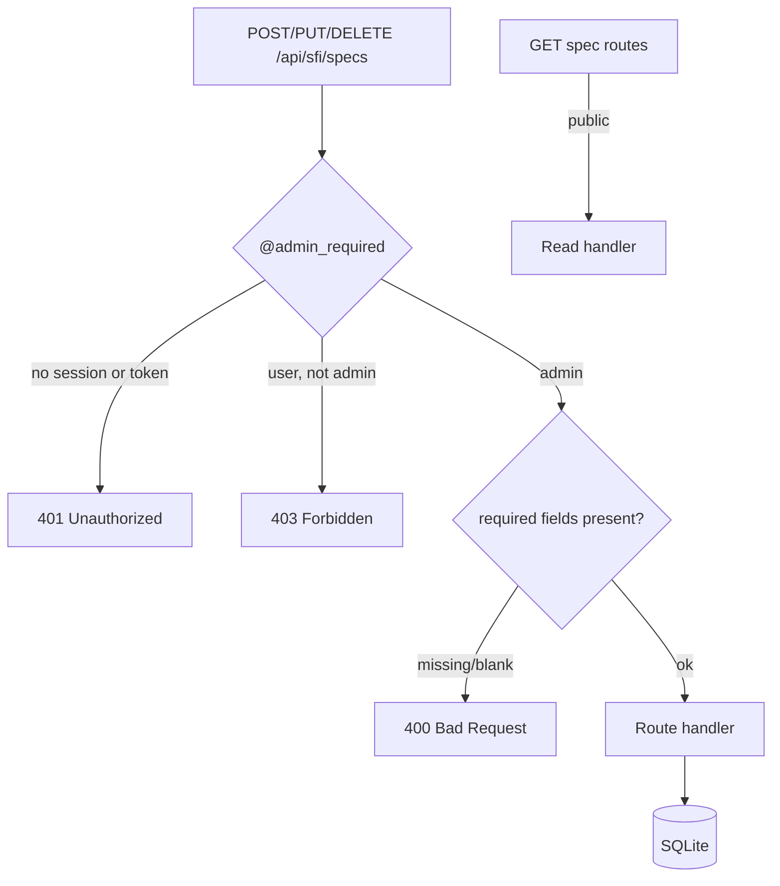

# SFI Foundation Prototype Backend

This repository contains the Flask API backend for the Greppers SFI Foundation capstone prototype. It supports the SFI frontend with specification search, machine-learning classification, chatbot responses, authentication, and user gear tracking.

The prototype is meant to show how SFI Foundation's public standards and PDF resources could become easier to search, update, and personalize. It is not a production replacement for the official SFI Foundation website.

## Backend Role

The Flask backend provides:

- SFI specification database import and API access.
- Spec search, category, stats, create, edit, and delete endpoints.
- Text-based ML classifier for matching part descriptions to SFI specs.
- Gemini-backed chatbot endpoint for SFI spec questions.
- User authentication and current-user lookup through the existing starter auth system.
- Authenticated "My Gear" storage for user safety equipment.

## Important Files

| Path | Purpose |
| --- | --- |
| `main.py` | Registers Flask blueprints, including all SFI APIs. |
| `api/sfi_spec.py` | SFI spec list/search/CRUD/categories/detect/stats endpoints. |
| `api/sfi_classifier.py` | ML text classifier endpoints. |
| `api/sfi_chat.py` | Gemini-backed chatbot endpoint. |
| `api/user_gear.py` | Authenticated user gear CRUD endpoints. |
| `model/sfi_spec.py` | SQLAlchemy model for SFI specs and import from frontend JSON. |
| `scripts/ingest_sfi_pdfs.py` | Downloads and indexes text chunks from official SFI spec PDFs. |
| `model/sfi_classifier.py` | TF-IDF plus LinearSVC classifier for part/spec prediction. |
| `model/user_gear.py` | SQLAlchemy model for user equipment tracking. |
| `__init__.py` | Flask app setup, CORS, environment config, and database configuration. |

## SFI API Endpoints

Implemented endpoints:

| Method | Endpoint | Purpose |
| --- | --- | --- |
| `GET` | `/api/sfi/specs` | List all specs, with optional `?category=` filter. |
| `POST` | `/api/sfi/specs` | Create a validated canonical spec (admin only). |
| `GET` | `/api/sfi/specs/search?q=...` | Keyword search across spec number, product name, category, and subcategory. |
| `GET` | `/api/sfi/specs/<id>` | Get one spec by ID. |
| `PUT` | `/api/sfi/specs/<id>` | Update the canonical spec by ID (admin only). |
| `DELETE` | `/api/sfi/specs/<id>` | Archive the canonical spec with explicit confirmation (admin only). |
| `GET` | `/api/sfi/categories` | Return distinct SFI spec categories. |
| `GET` | `/api/sfi/stats` | Return total specs, categories, subcategories, and category counts. |
| `POST` | `/api/sfi/classify` | Classify a free-text part description into likely SFI specs. |
| `GET` | `/api/sfi/classifier/status` | Return classifier training/status metadata. |
| `POST` | `/api/sfi/chat` | Send a chatbot message and receive a Gemini-generated response with `sources` (`spec_number`, `page`, `url`). Website citations use `null` for unavailable spec/page fields. |
| `GET` | `/api/sfi/gear` | List current authenticated user's gear. |
| `POST` | `/api/sfi/gear` | Add gear for the current authenticated user. |
| `DELETE` | `/api/sfi/gear/<id>` | Delete one current-user gear item. |

Partially implemented or prototype-only behavior:

- `POST /api/sfi/detect` exists, but it is keyword-based. It is separate from the browser-side detector in the frontend.
- Administrative user/group/gear endpoints are implemented and require their respective permission groups.

## Data Flow

The importer and classifier JSON fallback share `sfi_config.load_specs()`.
The default source is sibling `Frontend/_data/sfi_specs.json`:

```text
sfi-foundation/
  Frontend/_data/sfi_specs.json
  Backend/
```

Set `SFI_SPECS_PATH` for a different layout (for example this workspace's
`../SFI-Frontend/_data/sfi_specs.json`). Relative overrides resolve from the
Backend repository, never the shell's working directory; absolute paths and
`~` are supported. Empty uses the default. Missing files, malformed JSON and
invalid entries raise `SpecDataError` with the resolved path. Validation occurs
before the importer clears rows. Classifier retraining still prefers current
DB rows so admin edits remain supported; JSON fallback uses the same loader.
Saved classifiers are retrained when the training-data fingerprint changes.

## SFI PDF Text Ingestion

Run the ingestion pipeline from the repository root:

```bash
python scripts/ingest_sfi_pdfs.py
```

The script reads unique `spec_pdfs` paths from `sfi_specs.json`, resolves relative
paths against `https://sfifoundation.com/wp-content/pdfs/`, and stores downloaded
PDFs in the ignored `instance/sfi_pdf_cache/` directory. Set `SFI_PDF_BASE_URL`
to override that base. Cached valid PDFs are reused on later runs. Text is
extracted page-by-page and stored as overlapping 800-character chunks in
`sfi_spec_chunks`; each row has a `spec_id`, one-based `page`, and per-spec
`chunk_index`. A successful re-run replaces that spec's chunks rather than
duplicating them. Failed downloads, scanned/no-text PDFs, and parse errors are
logged and skipped without discarding existing chunks.





## Local Setup

Create and activate a Python virtual environment:

```bash
python -m venv venv
source venv/bin/activate
```

Install dependencies:

```bash
pip install -r requirements.txt
```

Copy the placeholder-only example and replace passwords and the session secret:

```bash
cp .env.example .env
```

The app loads Backend's `.env` independently of the current directory. Existing
environment variables take precedence. Gemini is optional; database credentials
are optional (blank selects local SQLite). `FLASK_PORT` defaults to 8605.
`IS_PRODUCTION=true` retains the existing HTTPS credential-cookie behavior for
the current Open Coding Society service; its cookie domain is still
`.opencodingsociety.com`. A replacement host needs cookie/deployment verification.

Initialize **only a disposable local database**:

```bash
python scripts/db_init.py
```

This initializer drops tables after confirmation. Do not run it against an
existing/shared database to apply this configuration change; no schema migration
is required. The repository includes prototype SQLite files: in a disposable
clone only, use a new empty `instance/volumes/user_management.db` and accept the
initializer prompt (main imports create tables before that prompt).

Run the backend:

```bash
python main.py
```

### Local administrator bootstrap and credential recovery

Normal startup creates legacy tables and seeds permission groups, but does not
create users or replace their passwords. `ADMIN_UID`/`ADMIN_PASSWORD` in `.env`
are bootstrap/recovery inputs; editing them does not change an existing database
account. Do not run the destructive `db_init.py` to repair login.

For an existing local SQLite database, use the explicit recovery command below
from Backend with the same virtual environment as `main.py`. Replace the UID
with the exact configured `ADMIN_UID`; never put the password on the command
line. The command reads `ADMIN_PASSWORD` from Backend's `.env` (shell variables
still take precedence), requires the existing password-strength validation,
and never prints credentials or hashes.

```bash
# First administrator only: dry run, then explicitly confirmed application.
python scripts/admin_credentials.py --database-path "$PWD/instance/volumes/user_management.db" --uid '<configured-admin-uid>' --bootstrap --dry-run
python scripts/admin_credentials.py --database-path "$PWD/instance/volumes/user_management.db" --uid '<configured-admin-uid>' --bootstrap --apply

# Existing authorized administrator: use its reviewed numeric database ID.
python scripts/admin_credentials.py --database-path "$PWD/instance/volumes/user_management.db" --uid '<configured-admin-uid>' --user-id 123 --dry-run
python scripts/admin_credentials.py --database-path "$PWD/instance/volumes/user_management.db" --uid '<configured-admin-uid>' --user-id 123 --apply
```

`--apply` validates the plan and requires typing `APPLY` before writing, then
rechecks it under a database write lock. The absolute path must match Flask's
resolved database. Relative `SFI_DATABASE_URI` SQLite paths resolve beneath
Backend's `instance/`, independent of the working directory. Production and
non-SQLite recovery are refused; use a separately reviewed operational procedure
for those systems. No tables are dropped or created by this command: run normal
startup first if the local schema has not been created.

Bootstrap refuses existing administrators, existing reserved identities, and
case/space/accent conflicts. It adds only the configured first administrator
with the Admin role and administrators group. Repair requires the exact UID and
numeric ID of an already authorized administrator, changes only its password,
and preserves users, roles, memberships and group permissions. Missing or
conflicting identities require operator review; no arbitrary user is elevated.
Restart a running Backend if you changed `.env`, then sign in through the local
Frontend at `http://localhost:4500/login/`. API login uses an HttpOnly JWT cookie;
Flask-Login sessions remain supported by protected APIs.

The expected local backend base URL is:

```text
http://localhost:8605
```

## Frontend Integration

The companion frontend expects the backend at:

- Local: `http://localhost:8605`
- Deployed: `https://greppers-be.opencodingsociety.com`

The frontend pages that depend on this backend include:

- `/sfi-specs/` for specs, stats, classifier, and spec CRUD.
- `/quiz/` for authenticated gear sync.
- `/login/` and `/signup/` for auth.
- Site-wide chatbot widget for `/api/sfi/chat`.
- `/admin/`, although the required admin endpoints are currently missing.

Flask owns credentialed CORS, including OPTIONS; both checked-in nginx templates
forward requests without adding CORS headers. Exact allowed origins are
`https://sfi-foundation.github.io` and HTTP localhost/127.0.0.1 ports
4000, 4100, 4500, 4600, 8000, 8080 and 8605. Origins have no `/Frontend` path.
Unapproved Origin headers receive 403 without allow-origin headers; requests
without Origin remain usable by CLI clients. `Vary: Origin` separates caches.
Authentication/authorization remain required independently of CORS.

Frontend `sfi_api_base` in `_config.yml` configures the shared API base for
SFI pages and auth. Blank preserves the current service listed above; no new
production URL is confirmed. Deployment/nginx reload, browser authentication
on Pages, and production CORS verification remain pending.

See [the feature diagram and capstone notes](docs/sfi-config.md).

## Known Gaps

- The standalone admin portal requires an authenticated account with administrative group permissions.
- Canonical catalog writes require administrator authorization; deletion is an archive preserving legacy rows.
- Gear API supports pending/approved/rejected status, owner metadata, review notes and authorized all-user views; PUT review and PATCH status are supported.
- Chatbot retrieval includes relevant spec rows, PDF chunks, and indexed SFI website pages.
- No PDF extraction, summarization, vector search, or RAG layer exists yet.
- Chatbot does not yet retrieve PDF chunks or crawl the website; it only receives compact spec rows from the database.
- PDF extraction and chunk storage are implemented; PDF summaries, search, and chatbot retrieval remain future work.
- `/api/sfi/detect` is keyword-based and separate from the frontend's TensorFlow.js image detector.
- Catalog/API/import/migration/authentication regression coverage is documented in `docs/sfi-phase1-repairs.md`.

## Future Roadmap

- Add admin-auth-protected SFI management endpoints.
- Implement `/api/sfi/me`, `/api/sfi/users`, `/api/sfi/groups`, `/api/sfi/gear/pending`, and `/api/sfi/gear/all` or update the frontend admin page to use existing APIs.
- Extend `UserGear` with status, source, owner/admin review fields, reviewer notes, and timestamps.
- Add a PDF ingestion pipeline that downloads or reads SFI PDFs, extracts text, chunks/indexes content, and exposes summary/search endpoints.
- Run `python scripts/index_sfi_site.py` to refresh the chatbot's searchable snapshot of the main SFI Foundation pages.
- Upgrade the chatbot further with citations and broader PDF retrieval before calling Gemini.
- Add route/API tests for SFI specs, classifier, chat error handling, and gear CRUD.

## Handoff Checklist

Before continuing backend work:

- Confirm sibling `Frontend/_data/sfi_specs.json` exists, or set `SFI_SPECS_PATH`.
- Initialize only a disposable database with `python scripts/db_init.py`; preserve existing data.
- Start the backend and test `GET /api/sfi/specs`.
- Test `GET /api/sfi/classifier/status` to confirm the classifier trained.
- Configure `GEMINI_API_KEY` before testing `POST /api/sfi/chat`.
- Run `python scripts/ingest_sfi_pdfs.py` to refresh the local SFI PDF chunk index.
- Treat the `/admin/` frontend as unfinished until the backend admin endpoints and permission checks are added.

## SFI spec write access (admin only)

`POST/PUT/DELETE /api/sfi/specs[/<id>]` are protected by `@admin_required` (`api/auth_utils.py`). GET routes stay public. The `/sfi-specs/` admin panel is only shown when `/api/sfi/me` reports an admin.



See [Phase 1 repairs, localhost QA, and launch instructions](docs/sfi-phase1-repairs.md) for the corrected catalog counts and current acceptance evidence.


## Account presentation preferences and database setup

The README's supported database choices remain distinct: SQLite is the local
fallback; configured MySQL uses PyMySQL. Production requires authenticated MySQL
and strong configured secrets. `SFI_DATABASE_URI` is an explicit override, intended
for isolated databases; never put a credential-bearing URI in command history or
reports. `.env` is ignored by Git and loaded from this repository regardless of cwd.
Environment variables override `.env`. Do not overwrite an existing `.env`.

For a fresh clone only:

```bash
python3 -m venv venv
. venv/bin/activate
pip install -r requirements.txt
test -e .env || cp .env.example .env
# Edit .env locally; never commit it.
python -c 'import secrets; from pathlib import Path; p=Path(".env"); s=p.read_text(); s=s.replace("SECRET_KEY=\n", "SECRET_KEY="+secrets.token_urlsafe(48)+"\n"); p.write_text(s); p.chmod(0o600)'
```

The generation command fills only an empty session secret and never prints it.
For stable sessions across restarts, configure that secret. Blank local bootstrap
password settings are independently generated per process and do not change
existing accounts. Production must explicitly configure strong `DEFAULT_PASSWORD`
and `ADMIN_PASSWORD` through its approved secrets mechanism. Normal startup never
creates privileged users or resets passwords.

| Variable | Meaning |
| --- | --- |
| `DB_ENDPOINT` | MySQL hostname; blank with other credentials selects local SQLite |
| `DB_PORT` | MySQL port, default `3306`, validated range 1–65535 |
| `DB_NAME` | MySQL database name, default `user_management` |
| `DB_USERNAME`, `DB_PASSWORD` | MySQL credentials; configure together with endpoint |
| `SFI_DATABASE_URI` | Optional explicit DB URI; relative SQLite paths resolve under `instance/` |
| `SECRET_KEY` | Stable generated session secret, 32+ random characters |
| `IS_PRODUCTION` | `false` locally; `true` enforces HTTPS cookies and MySQL |
| `FLASK_PORT` | API port, default `8605` |
| `SFI_SPECS_PATH` | Existing specification source configuration |

For MySQL development, create an empty development database with a dedicated
account using your normal MySQL administration tools. Example SQL, with placeholders:

```sql
CREATE DATABASE sfi_development CHARACTER SET utf8mb4;
CREATE USER 'sfi_dev'@'localhost' IDENTIFIED BY '<generated-development-password>';
GRANT ALL PRIVILEGES ON sfi_development.* TO 'sfi_dev'@'localhost';
```

Set endpoint, port, name and both credentials in `.env`; leave `SFI_DATABASE_URI`
blank when using these variables. Do not substitute an existing production schema.
For SQLite development leave all MySQL credentials blank. Preserve existing files
under `instance/volumes/`; use an explicitly named disposable SQLite URI for QA.

### Additive settings migration and rollback

`model/sfi_settings.py` adds `sfi_account_settings` with one row per authenticated
user, a validated JSON preference object and revision. It does not change users,
roles, profiles, onboarding answers or catalog records. Normal startup follows
the existing additive `create_all` convention. For explicit migration of an
existing database, stop writers and use the existing backup procedure, then:

```bash
python scripts/migrate_sfi_settings.py --from-env
python scripts/migrate_sfi_settings.py --from-env  # repeat safely
python main.py
```

The explicit migration imports configuration, not `main.py`; it does not seed data
or call `drop_all`. It requires an existing `users` table. A new disposable clone
can first start `main.py` to create legacy tables. Do not use destructive
`scripts/db_init.py` as an upgrade mechanism. The existing catalog migration is
separate; see `docs/sfi-phase1-repairs.md`.

Rollback: first deploy the previous application and leave the unused settings
table intact. `--downgrade` removes only an empty settings table and refuses to
discard saved settings. MySQL DDL is not transactional; review deployment plans
and normal backups before applying any production migration. This task does not
authorize production modification.

### Account settings API

Authenticated `GET /api/sfi/settings` returns
`{"version":1,"revision":0,"preferences":{}}` before the first save. PATCH accepts
exactly `version`, the last read integer `revision`, and allowlisted `preferences`.
It returns the incremented revision after commit. Conflicts return 409; reload
rather than overwriting another device. Invalid values/identity/role keys return
400; non-JSON returns 415, oversized payloads 413, unauthenticated requests 401,
and database failures 503. Responses are `no-store`. Identity comes exclusively
from existing authenticated cookies/tokens; no user ID is accepted. JSON PATCH
uses the existing exact-origin credentialed CORS policy and preflight protection.
The endpoint has a 16 KiB request bound within the app's existing 5 MiB global
limit; no new per-user rate limiter is introduced.

No notification subscriptions or unsupported search sorts/layouts are stored.
Opted-in remembered category values remain browser-local; only their enablement
setting synchronizes. Onboarding preference APIs remain separate and unchanged.

### Connectivity, tests and troubleshooting

Start Frontend at `http://localhost:4500` as described in its README. For local
connectivity, `curl -i http://localhost:8605/api/sfi/settings` should return 401
without a session, confirming the endpoint is protected. Sign in through the UI,
change a setting, and verify account-save feedback and a second browser context.
A 503 catalog response requires the separate catalog initialization, not an empty
success. An API connection error requires checking the configured base URL, port,
credentials, database existence and exact CORS origin. Use `localhost` consistently;
its cookies are distinct from `127.0.0.1`. Production domain/cookie configuration
must be verified separately by the deployer. Never paste credential-bearing
exceptions or `.env` contents into issues.

```bash
python testing/test_sfi_settings_config.py
python testing/test_sfi_profile.py
PYTHON_DOTENV_DISABLED=1 SFI_DATABASE_URI=sqlite:// python -m unittest discover -s tests -v
```

Profile tests copy source into a temporary directory, never copy `.env` or existing
databases, create synthetic accounts and verify real SQLite writes, migration
repeatability, account isolation, validation, failures, roles and process-restart
persistence. Opt-in MySQL account tests additionally accept `SFI_QA_MYSQL_URI`
through the environment only for a fresh localhost schema prefixed
`sfi_preferences_qa`, port 13376. Use a fresh schema per run; the suite retains
its synthetic rows. Supply generated credentials privately, never in a report.
Three separate catalog MySQL tests require their own `sfi_phase1_qa` fixture.

For the customer, `python testing/test_sfi_profile.py --demo` starts a disposable
Flask API on port 8865 with synthetic catalog entries (override with `SFI_DEMO_PORT`); register synthetic users
through the normal UI. Stop it after the demonstration. It never opens local
customer databases, seeds privileged accounts or modifies real credentials.

See the paired Frontend's `docs/teacher-deployment-preferences-verification.md`
for evidence and the customer demonstration guide. No deployment is performed.
