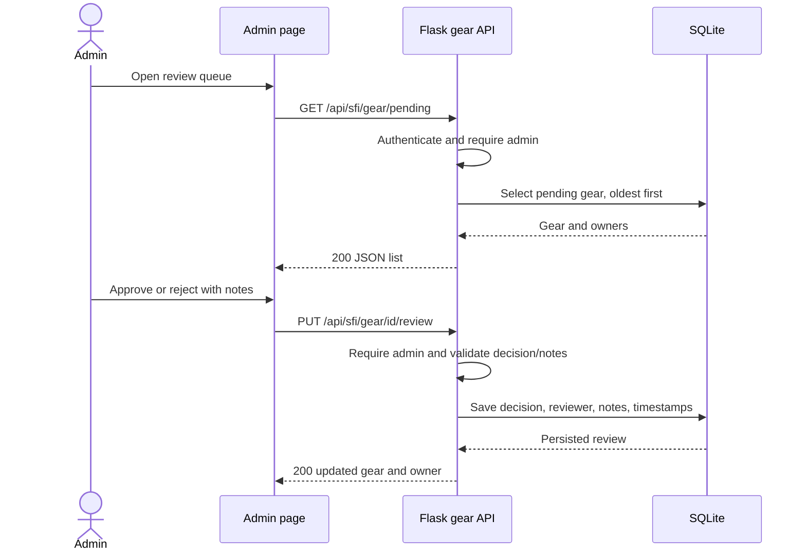

# Gear review API — Backend #4

Staff can list pending submissions, filter all gear, and approve or reject items.
Owners see the saved result and notes through their existing My Gear endpoint.
This builds on the review model and migration merged in PR #24 (Backend #3).

## Design and contracts

The issue identifies two needs: staff need a review queue and owners need useful
feedback while their gear remains private. How might staff make attributable
decisions without breaking existing clients? The chosen design extends the
existing blueprint and shared authorization helper instead of introducing a
second moderation system. Backend #4 is assigned to DrDeyar and has High priority
on the project board. These design notes derive from the issue and current code;
they do not claim interviews or stakeholder approval.

| Method and route | Contract |
| --- | --- |
| `GET /api/sfi/gear/pending` | Admin only. Pending items ordered by creation time, oldest first; ID breaks ties. Includes owner `id`, `uid`, and `name`. |
| `GET /api/sfi/gear/all` | Admin only. Newest first, with optional `status` and `user` filters combined with AND. |
| `PUT /api/sfi/gear/<id>/review` | Admin only. JSON object with `status: approved` or `rejected`, plus optional text `notes`; rejection requires nonblank notes. Returns the saved record and owner. |
| `PATCH /api/sfi/gear/<id>/status` | Existing compatible route. Uses `note` and also permits `pending` resets. Admins and existing delegated `can_approve_gear` reviewers can use it. Rejection also requires nonblank notes. |

The three requested routes use `api.auth_utils.admin_required`: trusted Admin
role or membership in the administrators group. Delegated approval/view flags
alone do not grant access to those admin-only routes. The legacy PATCH route
retains its delegated permission behavior. Existing member GET/POST/DELETE and
permission-based staff auto-approval behavior remain intact.

`status` accepts `pending`, `approved`, or `rejected` for listing. `user` is a
positive numeric owner ID from `owner.id`, not a username. Blank, repeated,
malformed, and out-of-range filter values return 400; a valid filter with no
matches returns `[]`. Status strings are trimmed and lowercased. Review notes
are trimmed, and non-text notes return 400. Approvals may omit notes.

Example review body:

```json
{"status": "rejected", "notes": "Certification label has expired; please recertify."}
```

Reviewer identity and audit timestamps come from the authenticated server-side
user and model, never from client-supplied audit fields. Successful decisions
persist `status`, `reviewer_id`, `reviewer_notes`, `reviewed_at`, and `updated_at`.
Existing `reviewNote`, `reviewerId`, `reviewedAt`, and `updatedAt` JSON keys remain.

## Flow



## Acceptance and verification

The acceptance checks cover the pending queue, combined filters, approval and
rejection persistence, required rejection notes, owner-visible results, and
denial of unauthorized access. Error responses are 401 for missing/expired
authentication, 403 for insufficient access, 400 for invalid filters/bodies, and
404 for an admin reviewing a missing item. Authorization runs before item lookup
or request validation. A database write failure rolls back and returns 500.

Run from the repository root with project dependencies installed:

```sh
PYTHON_DOTENV_DISABLED=1 python -m unittest discover -s tests -v && python testing/test_sfi_profile.py
```

The focused suite uses real routes, authorization helpers, groups, and models on
isolated in-memory SQLite. It verifies role and group admins, session and JWT
authentication, pending ordering, filters, validation, audit-field persistence,
owner isolation, rollback, legacy route compatibility, and the existing model
and migration checks. The full-app runner uses a disposable source snapshot,
blocks external networking, and exercises actual login and the review workflow.
No existing application database is reset or migrated by these tests.

## Deployment and presentation

No new columns are introduced by this issue. Existing databases must already
have the Backend #3 schema; follow its [migration instructions](user-gear-review.md)
before deploying the merged model to an old SQLite database. MySQL needs its
separately reviewed schema migration. Backend #4's PR is ready for review after
the checks pass; shared deployment, presentation, and stakeholder acceptance
must be recorded when they actually happen.

Demonstrate a member submitting two items, an admin viewing the oldest pending
items, one approval, and one rejection with notes. Refresh the member's gear list
to show persisted results; demonstrate both filters and a non-admin 403. Retain
the PR, Key Commit, test commands/results, and acceptance evidence in issue #4.
