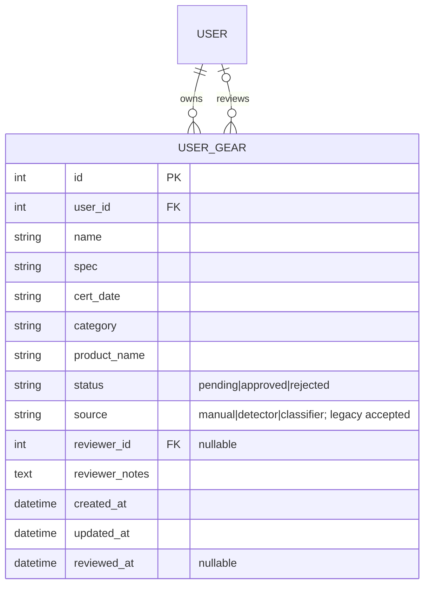
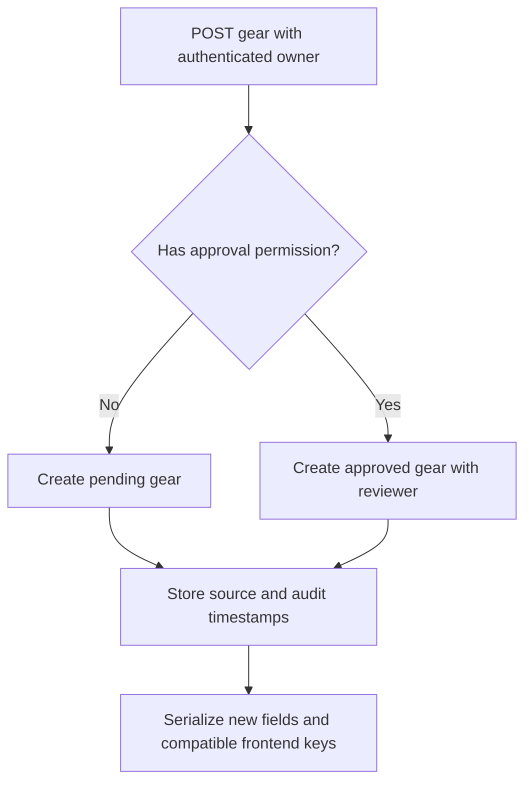
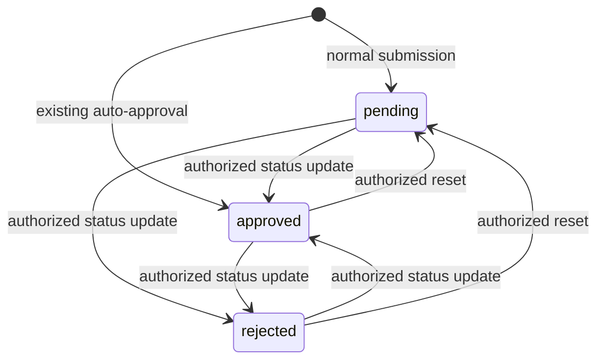

# UserGear review data — Backend #3

Gear now stores `status`, `source`, nullable `reviewer_id`, `reviewer_notes`,
`created_at`, and `updated_at`. Timestamps are UTC and serialized as ISO 8601.
`reviewed_at` records the review time separately. Normal submissions default to
`pending`; the existing auto-approval for members with `can_approve_gear` remains.

## Design basis and acceptance

The existing issue defines the user need: owners need to see review results and
staff need attributable review records. How might we add that information while
keeping existing gear submissions and frontend clients working? Resetting the
database is simpler but loses records; the selected approach adds missing fields
with an additive migration and retains compatible field names.

Acceptance requires a fresh schema, preservation of existing records and review
metadata during migration, pending defaults for normal submissions, serialized
review/timestamp fields, and working authenticated GET/POST/DELETE operations.
The existing staff auto-approval policy is preserved. This is a design derived
from issue #3 and current code; no interview or stakeholder meeting is claimed.

## Compatibility and data flow

`to_dict()` and `read()` return the new snake_case review and timestamp fields.
Existing frontend keys (`reviewNote`, `reviewerId`, `reviewedAt`, `createdAt`)
remain, with `updatedAt` added. The Python `review_note` attribute aliases
`reviewer_notes`; both JSON note names always expose the same value. Notes are
stored as unrestricted text rather than silently cut off at 500 characters.

Sources include `manual`, `detector`, and `classifier`. Older values such as
`ai-detection` and `search` remain accepted. Creating gear ignores client-supplied
status, reviewer, notes, and audit timestamps. ORM updates refresh `updated_at`;
raw SQL writers must maintain their own timestamps.







The state diagram reflects the existing PATCH status endpoint, which accepts all
three states. User editing/resubmission is not implemented. The requested PUT
review endpoint and mandatory rejection notes belong to Backend #4.

## Existing SQLite database: preserve data

Stop the server, then run from the repository root:

```sh
python scripts/migrate_user_gear.py instance/volumes/user_management.db
```

The standalone script requires only Python's standard library. It creates a
uniquely named SQLite backup beside the database, adds missing columns in a
transaction, and copies any legacy `review_note` into `reviewer_notes`. Existing
status, source, reviewer and timestamps are preserved. Old rows without a
creation time receive the migration time (the original time is unknown); missing
update times use the review time or creation time. It is safe to run repeatedly.
The old physical `review_note` column is retained for data preservation but is no
longer written by the updated model. Restart with the new code after migration.

This migration is SQLite-only; MySQL deployments need a separately reviewed
schema migration before running the updated model. `db.create_all()` does not
upgrade existing tables.

## Fresh database

With project dependencies installed, `python scripts/db_init.py` builds the new
model schema. The backup helper now skips missing source databases. The existing
initializer resets populated databases after confirmation: use the migration
above to preserve existing data.

## Verification

```sh
python -m unittest discover -s tests -v
```

The tests create isolated in-memory databases using the real models, auth,
permission helpers and gear routes. They check fresh schema creation, authenticated
POST/GET/DELETE, pending defaults despite spoofed review fields, source storage,
owner isolation, unauthenticated access, note compatibility, timestamps, invalid
model statuses, staff auto-approval, and repeated migration of both pre-review and
legacy review schemas without losing their data. They also check backup recovery
and atomic rollback on a migration failure.

On October 22, 2026, all 10 focused tests passed. The existing isolated full-app
suite (`python testing/test_sfi_profile.py`) also passed all 13 tests, including
authentication, gear creation, owner isolation, and staff moderation. The actual
`scripts/db_init.py` completed in a separate disposable source snapshot with
external networking disabled, and the resulting schema contained every required
review column. Existing application databases were not used for these checks.

## Review demonstration

1. Stop the development server and migrate a disposable copy of a legacy SQLite
   database. Verify its gear IDs, owners, notes and review metadata are retained.
2. Start the updated backend, sign in as an ordinary member, and add an item.
   Confirm `pending` status and both creation/update timestamps in POST and GET.
3. Use the existing authorized PATCH status action to review that item. Refresh
   the member's gear list and verify the note aliases and reviewer information.
4. Confirm another member cannot delete the item; confirm its owner can.
5. Present the results and record reviewer acceptance in issue #3. Deployment,
   presentation and stakeholder acceptance remain pending until actually done.
