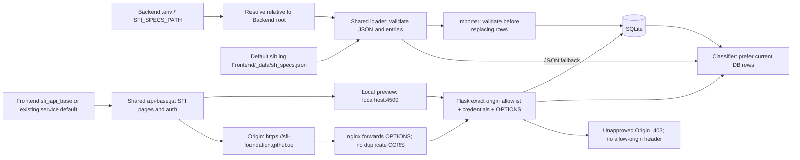

# Backend #8 — configuration capstone

Owner: @ruhaanb622. Proposed priority: High. Branch: feature/8-sfi-config.
The list of spec objects manages importer/classifier input; validation sequences
path selection, decoding, and field checks, iterating over entries and selecting
clear failure messages. Tests compare default/custom paths, working directories,
invalid data, allowed and disallowed origins and preflights. These supporting
notes do not claim eligibility for an individual Create submission.

The source is validated before destructive import. Admin retraining continues
using DB edits; a fingerprint invalidates a saved classifier trained on other
input. No symlink is required. CORS includes credentials and preserves existing
auth handlers. The current frontend service remains the default because no
replacement URL was confirmed.

Development evidence is retained in issue #8. Deployment (including nginx syntax
check/reload on the target host), production authentication/CORS, presentation,
and stakeholder acceptance remain pending. Do not mark Done or auto-close.
